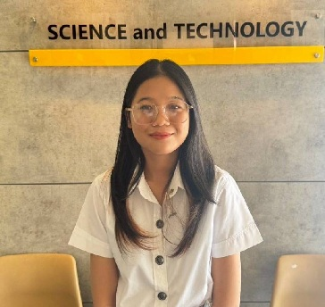
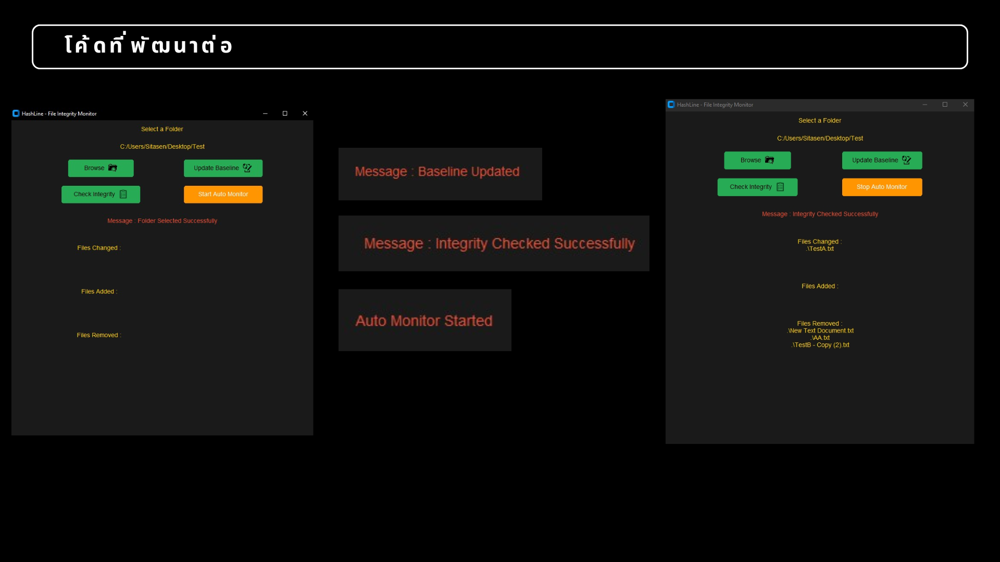

<table>
<tr>
<td width="160"></td>
<td>

## Hi, I'm Siriwimon Sitasen 👋

**Computer Science student @ Huachiew Chalermprakiet University** (GPA 3.78)
Embedded Systems · IoT · Full-Stack Development

🌐 [Portfolio](https://pear1790.github.io/My-portfolio/) · 📄 [Resume (EN)](./assets/ResumeEN.pdf) · [Resume (TH)](./assets/ResumeTH.pdf) · 💼 [LinkedIn](https://www.linkedin.com/in/%E0%B8%AA%E0%B8%B4%E0%B8%A3%E0%B8%B4%E0%B8%A7%E0%B8%B4%E0%B8%A1%E0%B8%A5-%E0%B8%AA%E0%B8%B4%E0%B8%95%E0%B8%B0%E0%B9%80%E0%B8%AA%E0%B8%99-b2713b39b) · ✉️ [Email](mailto:siriwimonsitasen1@gmail.com)

</td>
</tr>
</table>

### 👩‍💻 About Me

I'm a Computer Science student who likes working where hardware meets software — from ESP32 sensor devices to the web dashboards and desktop apps that use their data. I care about clean, well-documented code and solving problems step by step.

- 💼 **Now:** Web Developer Intern at **Pantavanij**
- 🔭 **Building:** Smart CPR Training Manikin (IoT) and ActivityFlow, a student activity management system
- 🌱 **Learning:** ESP32/Arduino, cloud IoT platforms, full-stack web development
- 🎯 **Open to:** roles in Web/Software Engineering, Full-Stack, Embedded/IoT, and R&D after graduating in 2027

---

### 🚀 Featured Projects

| Project | What it does | Tech |
|---|---|---|
| 🔧 **Smart CPR Training Manikin** *(in progress)* | Measures chest-compression depth and rate in real time, gives LED/buzzer feedback, and sends session data from an ESP32 to a web dashboard. | ESP32, C/C++, JavaScript |
| 🛸 **[TESA Top Gun Rally 2025](https://github.com/Pear1790/TESA-Top-Gun-Rally-2025)** | Detects and tracks small drones in video with YOLO and estimates their GPS coordinates with an ML model. | Python, YOLO, C |
| 📋 **[ActivityFlow](https://github.com/Pear1790/Student-Activity-Management-System)** | Role-based web platform that replaces paper workflows for student activities: proposals, scoring, notifications, PDF reports. | TypeScript |
| 🛡️ **[HashLine – File Integrity Monitor](https://github.com/Pear1790/File-Integrity-Monitor-master-FIM-)** | Watches a folder in real time and flags changed, added, or removed files by comparing SHA-512 hashes to a baseline. | Python, watchdog, CustomTkinter |
| 🏃 **[LIFE CAL](https://github.com/Pear1790/Life-Cal)** | Desktop health tracker: BMI/BMR/TDEE, calorie and exercise logs, weight-trend charts. MVC with Singleton and Repository patterns. | Java (JavaFX), SQLite |
| 🚑 **[Rescue Alert](https://github.com/Pear1790/Rescus-Alert)** | Accident reporting and tracking site for HCU staff, with login and status tracking. | PHP, MySQL |
| 🧺 **[Laundry Shop System](https://github.com/Pear1790/laundry-shop-system)** | Online ordering and tracking for a laundry shop: customer accounts, admin dashboard, configurable pricing engine, delivery zones, LINE notifications. | Node.js, SQLite, Docker |
| 🆘 **[Thai Emergency Guide](https://github.com/Pear1790/thai-emergency-guide)** · [▶ demo](https://pear1790.github.io/thai-emergency-guide/) | Offline first-aid PWA that guides bystanders step by step: CPR metronome, call script with live location, 17 emergency chapters. | JavaScript, PWA, Geolocation |
| 🍡 **[Thai Sweets Playland](https://github.com/Pear1790/thai-sweets-playland)** · [▶ play](https://pear1790.github.io/thai-sweets-playland/) | Browser games that teach Thai culture through desserts: 3D kitchen, floating-market runner, quiz and puzzle games. | three.js, JavaScript, PWA |

<b>More projects</b>

- 🎃 [Ghostly Garden](https://github.com/Pear1790/Ghostly-Garden) — Halloween farming game (Unity, Blender)
- 🔴 [Connect 4](https://github.com/Pear1790/Connect4_basic-game) — two-player browser game (HTML, CSS, JS)
- 🏨 [Harmony Hotel](https://github.com/Pear1790/Harmony-Hotel) — data analysis of the Thai hotel industry

---

### 🏆 Achievements

- 🎤 **Oral presentation** — *Tourist Attraction Recommendation Platform for People with Disabilities*, 8th Krung Kao Research National Academic Conference (Dec 2025)
- 💡 **Health TechX 2 "The Future"** — pitching competition, same project
- 🛸 **TESA Top Gun Rally 2025** — drone detection and tracking
- 📜 [Certificates](https://drive.google.com/drive/folders/1__ytC6mmHuG8uh0afaMWIW5pMaeVG1rX?usp=drive_link) · [Activities](https://drive.google.com/drive/folders/1WrQXadTtcFe11SWr21mQTXD75wLuIZaL?usp=drive_link)

---

### 🛠️ Tech Stack

**Languages**

**Embedded & IoT**

**Web, Data & Tools**

---

### 🤝 How I Work

Fast learner · systematic problem solver · clear documentation · calm under pressure · good team communicator
